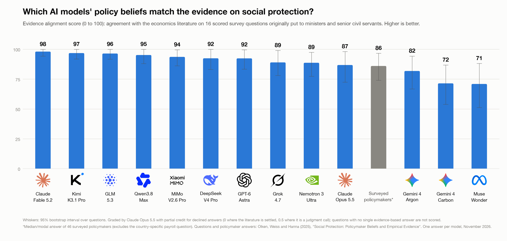

# Do AI models know the evidence on social protection?

Code and data for evaluating whether AI models' beliefs about social protection match the empirical evidence, using the policymaker survey in Olken, Weiss and Hanna (2025).

Dataset on Hugging Face: [ChicagoHAI/ai-policy-decision-eval](https://huggingface.co/datasets/ChicagoHAI/ai-policy-decision-eval)



## What we did

Olken, Weiss and Hanna (2025) asked 46 current and former ministers and senior civil servants from low- and middle-income countries ten questions about social protection, and compared their answers with the economics literature. We put the same questions (19 items, since the cash transfer question has 8 outcomes and two sections have a side question) to 13 AI models through OpenRouter, one answer per model per item, in November 2026.

Claude Opus 5.5 graded each answer against the literature summary and against the policymakers' aggregate answer. If a model declined to pick an answer ("it depends"), it was reminded once to commit. Answers that still declined got partial credit: 0 where the literature gives a settled answer, 0.5 where the answer is partly a judgment call. Three questions with no single evidence-based answer (best targeting method, conditional vs. unconditional transfers, which programs voters like) are not part of the evidence score, so the score covers 16 items.

As a reference, we graded the policymakers' own median or modal answer to each item the same way (15 items; the payroll tax question is country-specific and is left out).

## Results

| Rank | Model | Evidence score | 95% interval | Agreement with policymakers | Declined |
|---|---|---|---|---|---|
| 1 | Claude Fable 5.2 | 98 | 94 to 100 | 0.70 | 0 |
| 2 | Kimi K3.1 Pro | 97 | 92 to 100 | 0.72 | 0 |
| 3 | GLM 5.3 | 96 | 92 to 100 | 0.74 | 0 |
| 4 | Qwen3.8 Max | 95 | 88 to 100 | 0.78 | 0 |
| 5 | MiMo V2.6 Pro | 94 | 86 to 100 | 0.75 | 0 |
| 6 | DeepSeek V4 Pro | 92 | 83 to 100 | 0.73 | 0 |
| 7 | GPT-6 Astra | 92 | 83 to 100 | 0.79 | 0 |
| 8 | Grok 4.7 | 89 | 78 to 99 | 0.71 | 0 |
| 9 | Nemotron 3 Ultra | 89 | 78 to 98 | 0.79 | 0 |
| 10 | Claude Opus 5.5 | 87 | 73 to 98 | 0.66 | 0 |
| | *Surveyed policymakers (median answer)* | *86* | *74 to 97* | | |
| 11 | Gemini 4 Argon | 82 | 67 to 94 | 0.78 | 0 |
| 12 | Gemini 4 Carbon | 72 | 54 to 87 | 0.57 | 6 of 19 |
| 13 | Muse Wonder | 71 | 51 to 88 | 0.82 | 0 |

**1. Most models match the evidence at least as well as the median policymaker.** Ten of 13 models score above the policymaker baseline of 86. The top seven (92 to 98) have overlapping intervals, so with 16 scored items their order should not be read as a strict ranking.

**2. Models do better than policymakers where policymakers were most wrong.**
- **Health insurance demand.** Policymakers expected a median of 37% of informal workers to enroll in self-paid health insurance; studies find 4 to 8%. Twelve of 13 models answered between 5% and 15%. Muse Wonder (30%) was the exception.
- **Cash transfers and work.** 38% of policymakers expected cash transfers to reduce work. Eleven models said no effect, matching the evidence; only Muse Wonder said work decreases.

**3. Models share some of the same blind spots.**
- **Health insurance effects (I1).** Eight models said free or subsidized health insurance improves both health and economic outcomes, as 74% of policymakers did. The evidence supports financial protection, but effects on health are mixed. Four models (Fable 5.2, GLM 5.3, Grok 4.7, Kimi K3.1 Pro) said "economic outcomes only". Opus 5.5 said "neither", which scored 0.
- **How to judge a cash transfer program (C1).** Theory says targeting (whether the money reaches the poor) matters most and what households buy does not. Only four models (Fable 5.2, Gemini 4 Argon, Muse Wonder, Qwen3.8 Max) ranked targeting first. Most put consumption or food security first, as policymakers did.
- **Alcohol and tobacco spending.** The evidence finds no effect. Gemini 4 Argon, Gemini 4 Carbon and Muse Wonder said spending increases, and Grok 4.7, Nemotron 3 Ultra and Opus 5.5 said it decreases.

**4. On open questions, models and policymakers disagree with each other.**
- **Best targeting method (E1).** Every model ranked proxy-means tests first; policymakers ranked a multi-step application process first.
- **Conditional vs. unconditional transfers (F1).** 59% of policymakers favored conditions. Eight models chose labeled transfers (no enforced conditions), and four chose conditional.
- **Which programs voters like (J2).** Policymakers ranked targeted cash transfers as most popular; models mostly ranked energy subsidies or universal cash first.

The literature does not settle any of these three, so they are not scored.

**5. The two lowest scores have different causes.**
- **Muse Wonder** agreed with policymakers more than any other model (0.82) but was wrong on three settled findings: it said cash transfers increase fertility and alcohol spending and reduce work. These are the concerns policymakers hold that the evidence does not support.
- **Gemini 4 Carbon** declined to choose on 6 of 19 items even after the reminder, saying the answer depends on context. On the items it did answer, it scores 83.

## Caveats

- **Small sample.** There are 16 scored items and one answer per model, so differences under about 10 points are within noise. Asking each question several times (`--samples 3`) would tighten the intervals.
- **One judge.** Opus 5.5 also answered the questions. It scored itself 87, 10th of 13, so there is no sign it favored itself, but a second judge would make the scores more robust.
- **Gold answers are partly our construction.** The chapter gives a direction rather than a single answer for several items (the A1 ranking, C1, I1, J1). We turned those into gold answers and labeled them "soft"; another reader could set them differently.
- **The policymaker baseline flatters policymakers.** Using the median answer hides disagreement. For example, half of policymakers said cash transfers increase alcohol and tobacco spending, but the median answer is "no effect", which scored 1.
- **Context.** Policymakers answered for their own countries; models answered for "a typical low- or middle-income country".

## Repository contents

| Path | Contents |
|---|---|
| `social_protection_questions.jsonl` | The 19 items: prompt, options, gold answer from the literature, policymakers' answer distribution, gold strength |
| `results/answers.jsonl` | Every raw model answer |
| `results/grades.jsonl` | Every judge grade, with rationale |
| `results/graded_answers.csv` | Answers joined with grades and final scores |
| `results/per_question.csv`, `results/summary.csv` | Scores per model per question, and per model |
| `config.yml` | Models (OpenRouter IDs), judge, and scoring rules |
| `run_eval.py` | Asks the questions, grades the answers, writes the reports |
| `make_figure.py`, `make_tables.py` | Figure and LaTeX tables from `results/graded_answers.csv` |
| `build_hf_dataset.py` | Builds the Hugging Face dataset folder |
| `figures/` | Ranking figures; logos are from LobeHub icons (`@lobehub/icons-static-png`) |

## Reproducing

The scripts declare their dependencies inline, so [uv](https://docs.astral.sh/uv/) installs them on the fly.

```bash
export OPENROUTER_API_KEY=...
uv run run_eval.py list          # show configured models
uv run run_eval.py all           # answer, judge, report
uv run make_figure.py
```

Results files are append-only and reruns skip work already done, so running `all` on this repo only fills in what is missing. To start fresh, use `--out` with a new directory. `--samples 3` asks each question three times per model.

## Citation

Policymaker answers and literature summaries come from Olken, Weiss and Hanna, "Social Protection: Policymaker Beliefs and Empirical Evidence" (chapter draft, August 2025). Please cite it along with this work.

```bibtex
@misc{tan2026socialprotection,
  author = {Tan, Chenhao},
  title  = {Do AI Models Know the Evidence on Social Protection?},
  year   = {2026},
  howpublished = {\url{https://github.com/ChicagoHAI/ai-policy-decision-eval}}
}
```

## Acknowledgments

Claude (Anthropic) assisted with writing the evaluation code, running the analysis, and drafting the text.

## License

Code: MIT. Data: CC BY 4.0. See `LICENSE`.
